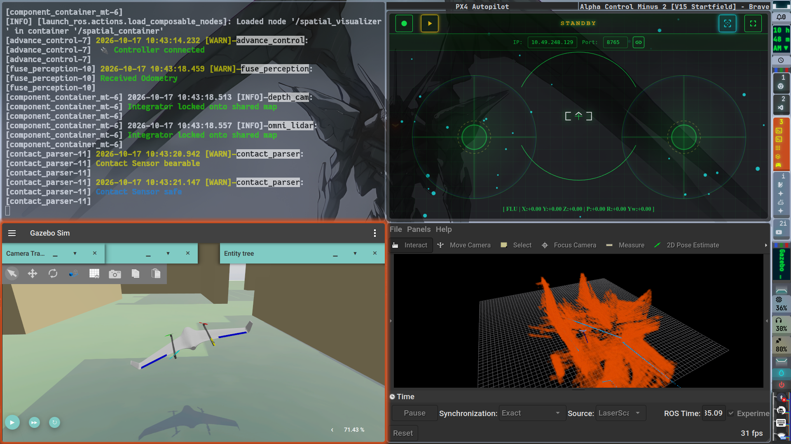

# Alpha Drone: Enhance VTOL Flight Stack

This repository contains the ROS2 harness and flight control stack for the Alpha Drone project. The architecture blends a deterministic spatial filter with a probabilistic AI neural network to push the dynamic flight envelope of VTOL (Vertical Take-Off and Landing) UAVs.

## System Architecture

The flight stack is divided into a multi-level hierarchy, running as optimized ROS2 nodes designed for low-latency, high-frequency execution.

### Level 3: Mission Planning & Intent

* Outputs simple velocity control to indicate human or mission movement intention, operating independently of underlying vehicle physics.

### Level 2: Twin Obstacle Avoidance (OA) Nodes

This layer houses the core flight intelligence, multiplexing between two distinct control paradigms.

* **Reactive OA Node (Deterministic):** A pure math spatial filter utilizing a 3D Voxblox Euclidean Signed Distance Field (ESDF). It models the drone as a safe collision geometry that scales dynamically with speed. This node calculates a conservative obstacle avoidance vector (velocity + yaw) based on ESDF gradients. Crucially, it also handles spatial extraction, providing two canonical spatial observation boxes (a body-aligned Coarse box and an intent-aligned Detail box) directly to the AI.

* **Acrobatic OA Node (Learned AI):** A Reinforcement Learning policy designed to fully exploit the vehicle's aerodynamic capabilities. It evaluates spatial tensors, current vehicle state, and flight intent to output normalized, direct actuator commands (motors and servos) at $\ge$ 100 Hz. During active flight, this node bypasses standard autopilot auto-leveling and static mixers to enable true acrobatic maneuvers.

### Level 1: Finalize Control Node (Sandbox & Fallback)

* Operates strictly on internal proprioceptive data (IMU, actuator states, velocity) without any reliance on the external spatial map.

* Acts as a probabilistic safety switch: if the AI generates an impossible physical command, this node drops the Acrobatic AI input and instantly triggers the safe Reactive vector fallback to stabilize the vehicle.

### Level 0: PX4 Autopilot Base

* Serves as the trusted foundation for state estimation (via EKF), sensor acquisition, and hardware interfacing.

* The conventional high-level trajectory tracking and rigid mixer logic are completely bypassed during Acrobatic OA operation, allowing the learned controller direct access to the VTOL's actuators.

## Demo

Implement architecture:

Development screenshot:

